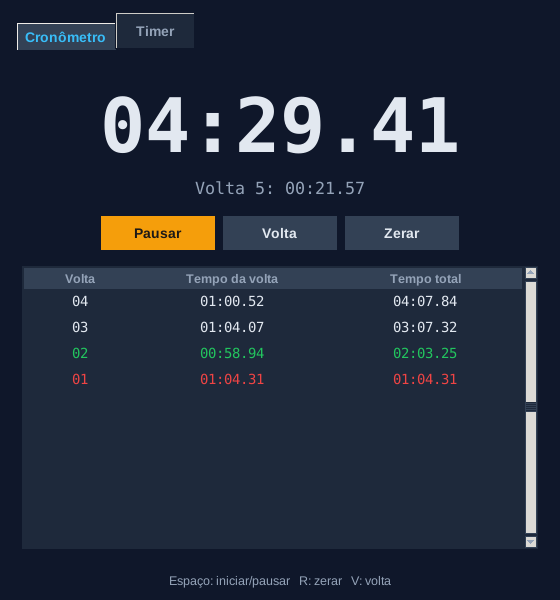
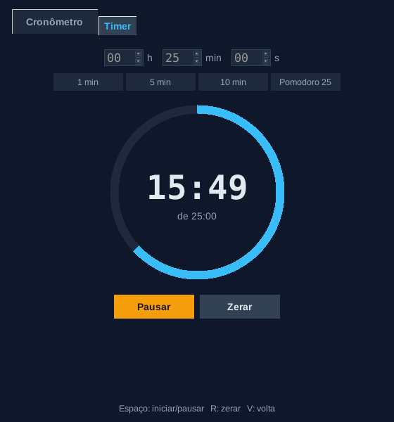

# Cronômetro

Cronômetro com voltas e timer regressivo com alarme, numa janela só. Funciona no **Windows, Linux e macOS** e não precisa instalar nenhuma biblioteca: só Python.

| Cronômetro | Timer |
|---|---|
|  |  |

## Funcionalidades

**Cronômetro**
- Contagem com centésimos de segundo.
- Iniciar, pausar, continuar e zerar.
- **Voltas**: a tabela mostra o tempo de cada volta e o total acumulado. A volta mais rápida aparece em verde e a mais lenta em vermelho.

**Timer**
- Defina horas, minutos e segundos, ou use os atalhos **1 min**, **5 min**, **10 min** e **Pomodoro 25**.
- Anel de progresso que fica vermelho nos últimos 10 segundos.
- Quando o tempo acaba, a janela vem para a frente, o tempo pisca e um aviso sonoro toca até você clicar em **OK**.

**Geral**
- Atalhos de teclado: `Espaço` inicia/pausa, `R` zera, `V` marca volta, `Ctrl+Tab` troca de aba.
- O tempo é medido com `time.monotonic`, então a contagem não se perde se o relógio do computador for ajustado.
- Ao fechar com uma contagem em andamento, o programa pede confirmação.

## Requisitos

- Python 3.9 ou mais novo, com Tkinter (já vem no instalador oficial do Windows e do macOS).
  - No Ubuntu/Debian, se faltar: `sudo apt install python3-tk`

## Como usar

```bash
git clone https://github.com/thi-araujo/Cronometro_.git
cd Cronometro_
python cronometro.py
```

No Linux/macOS, use `python3` no lugar de `python`.

## Estrutura do projeto

```
Cronometro_/
├── cronometro.py        # interface gráfica (Tkinter)
├── relogio.py           # lógica do cronômetro e do timer, sem interface
├── tests/
│   └── test_relogio.py  # testes automatizados
└── docs/                # capturas de tela usadas neste README
```

A lógica fica separada da interface, então `relogio.py` pode ser usado sozinho:

```python
from relogio import Cronometro, formatar

c = Cronometro()
c.iniciar()
# ...
c.marcar_volta()
print(formatar(c.decorrido()))  # ex.: 01:23.45
```

## Testes

Os testes usam um relógio falso, então rodam na hora sem esperar o tempo passar:

```bash
python -m unittest discover -s tests -v
```

## Histórico

Começou em 2022 como um contador regressivo de terminal (`input` em segundos e `print` a cada segundo), guardado junto com uma cópia da Calculadora Científica. Em 2026 virou um aplicativo com interface gráfica, cronômetro com voltas, timer com alarme e testes. A calculadora continua no repositório próprio: [Calculadora_Cientifica](https://github.com/thi-araujo/Calculadora_Cientifica).

## Autor

**Thiago Gomes Araújo**: [GitHub](https://github.com/thi-araujo) · [Portfólio](https://thi-araujo.github.io)
